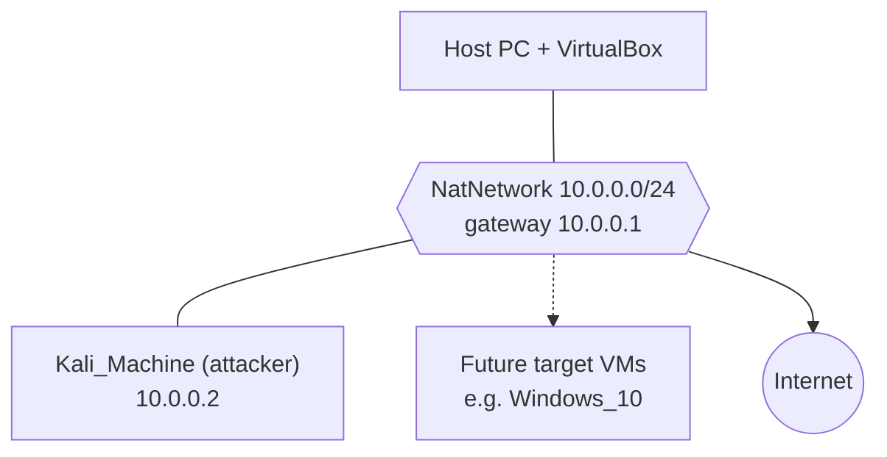
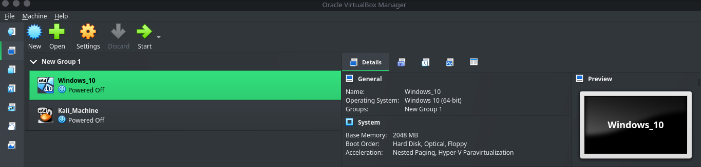
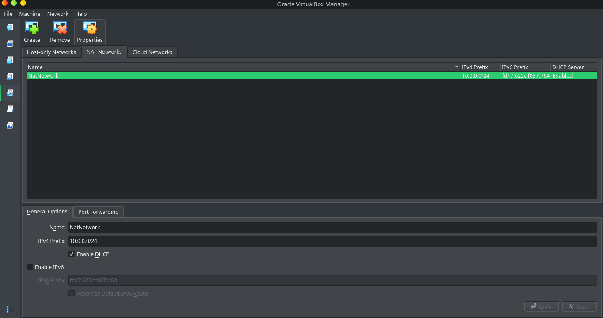
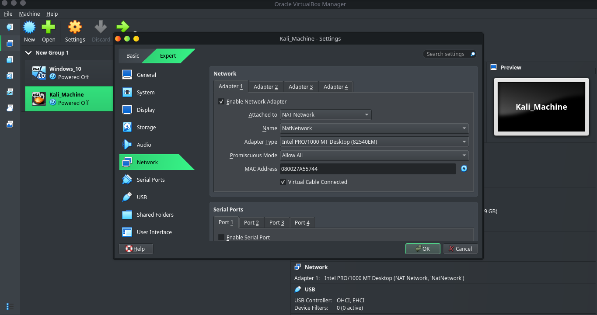

<div align="center">

# 🔐 Cybersecurity Lab Environment Setup

**An isolated VirtualBox lab with Kali Linux for ethical hacking and penetration-testing practice**


</div>

---

## 📌 Project Overview

This is my Week 1 project in the Networkwalks Cybersecurity program. I built a **private virtual security lab** on my own computer, with **Kali Linux** as the attacker machine, running inside **VirtualBox** on a dedicated NAT Network.

The lab gives me a safe, repeatable place to practise scanning, reconnaissance and vulnerability assessment. It is built so that vulnerable target machines can join the same network in later weeks. A Windows 10 VM has already been created in the same VirtualBox for that purpose.

---

## 🎯 Objectives

- Install VirtualBox and 7-Zip on the host.
- Create a NAT Network using the `10.0.0.0/24` subnet.
- Import Kali Linux and attach it to that network.
- Give Kali the fixed address `10.0.0.2/24` and confirm full Internet access.
- Enable the shared clipboard, drag and drop, and a shared host `Downloads` folder.
- Take a clean snapshot as a recovery baseline.
- Document everything, including the problems I hit.

### ✅ Requirement Checklist

| Requirement | Status |
|-------------|:------:|
| VirtualBox used as the base | ✅ |
| Kali Linux set up as the attacker machine | ✅ |
| Network in subnet `10.0.0.0/24` | ✅ |
| VirtualBox **NAT Network** used | ✅ |
| Clipboard and drag and drop enabled | TODO ✅ / ⬜ |
| Shared folder (host `Downloads`) enabled | TODO ✅ / ⬜ |
| Kali IP address is `10.0.0.2/24` | TODO ✅ / ⬜ |
| Kali has full Internet access | TODO ✅ / ⬜ |
| Clean snapshot taken | TODO ✅ / ⬜ |

---

## 🛡️ Purpose of the Lab

Once the lab is in place it can support:

- Network reconnaissance and port scanning
- Vulnerability assessment
- Packet capture and analysis
- Web application testing
- Exploitation practice against intentionally vulnerable VMs

> ⚠️ **Only test systems that you own or have written permission to test.** This lab is a closed environment on my own hardware.

---

## 🏗️ Lab Architecture



My VirtualBox Manager with both virtual machines created:



---

## ⚙️ Lab Configuration

| Component | Configuration |
|-----------|---------------|
| Host OS | TODO |
| Host RAM / CPU | TODO |
| Hypervisor | VirtualBox TODO_VERSION |
| Security OS | Kali Linux TODO_VERSION (VM name: `Kali_Machine`) |
| Kali RAM / CPUs | TODO |
| Virtual network | NAT Network (`NatNetwork`) |
| Network address | 10.0.0.0/24 |
| NAT Network DHCP | Enabled |
| IPv6 | Disabled |
| Kali IP address | 10.0.0.2/24 |
| Default gateway | 10.0.0.1 |
| DNS server | 8.8.8.8 |
| Adapter type | Intel PRO/1000 MT Desktop (82540EM), promiscuous mode: Allow All |

---

# 🪜 Lab Setup Procedure

## Step 1. Install 7-Zip
Kali's VirtualBox image is distributed as a `.7z` archive, so I installed 7-Zip to extract it.

## Step 2. Install VirtualBox
I installed the latest stable VirtualBox, and confirmed hardware virtualization (VT-x / AMD-V) was enabled on the host.

## Step 3. Create the NAT Network
In VirtualBox: **File → Tools → Network → NAT Networks → Create**.

```
Name:        NatNetwork
IPv4 Prefix: 10.0.0.0/24
DHCP:        Enabled
IPv6:        Disabled
```



I used a NAT Network (not plain NAT) because VMs attached to it can reach **each other** and the Internet, which is what a multi-machine lab needs.

## Step 4. Import Kali Linux and attach it to the network
I downloaded the official Kali VirtualBox image, extracted it, and added it to VirtualBox as `Kali_Machine`. Under **Settings → Network → Adapter 1**:

```
Attached to:   NAT Network
Name:          NatNetwork
Adapter type:  Intel PRO/1000 MT Desktop (82540EM)
Promiscuous:   Allow All
Cable:         Connected
```



## Step 5. Enable clipboard, drag and drop, and the shared folder
- **Settings → General → Advanced:** Shared Clipboard and Drag'n'Drop set to *Bidirectional*.
- **Settings → Shared Folders:** host `Downloads` folder added with auto-mount.

TODO: add the screenshot `4-screenshot-shared-folder.png` here (the Shared Folders list showing `Downloads`).

## Step 6. Configure the Kali IP address
Network settings → *Wired connection 1* → IPv4 → **Manual**:

```
Address:  10.0.0.2
Netmask:  24
Gateway:  10.0.0.1
DNS:      8.8.8.8
```

TODO: add the screenshot `5-screenshot-kali-ip-settings.png` here.

The same change can be made from the terminal with [`scripts/kali-static-ip.sh`](scripts/kali-static-ip.sh).

## Step 7. Take a clean snapshot
Once networking worked, I took a snapshot (**Snapshots → Take**) named `Clean Kali - Network Setup`, so I can always roll back to a known-good state.

TODO: add the screenshot `7-screenshot-snapshot.png` here.

---

# 🔎 Lab Verification

| Test | Command | Expected result |
|------|---------|-----------------|
| IP address | `ip a` | `10.0.0.2/24` on the main interface |
| Gateway | `ping -c3 10.0.0.1` | Replies received |
| Internet | `ping -c3 8.8.8.8` | Replies received |
| DNS | `ping -c3 google.com` | Name resolves, replies received |
| Shared folder | `ls /media/sf_Downloads` | Host files listed |
| All of the above | `./scripts/verify-lab.sh` | All checks PASS |

TODO: add the screenshot `6-screenshot-verification.png` here (terminal showing `ip a` and the ping results).

---

# 🐞 Problems Encountered & Solutions

> TODO: keep only the problems you **really** faced, in your own words. Delete the ones that did not happen to you.

## Problem 1. No Internet after setting the static IP
**Symptom:** TODO (describe exactly what you saw, e.g. `ping 8.8.8.8` failed).

**Cause:** With a manual IP on newer Kali / VirtualBox 7 builds, NetworkManager's duplicate-address detection can delay the connection.

**Solution:**
```bash
sudo nmcli connection modify "Wired connection 1" ipv4.dad-timeout 0
sudo nmcli connection down "Wired connection 1"
sudo nmcli connection up "Wired connection 1"
```
If name resolution still failed, I tried `10.0.0.1` as the DNS server instead of `8.8.8.8`. Connection names differ between systems, so check yours first with `nmcli connection show`.

## Problem 2. TODO (optional)
**Symptom / Cause / Solution:** TODO

---

# 💡 What I Learned

1. **NAT vs NAT Network.** A NAT Network lets several VMs talk to each other while sharing outbound Internet access. That is the right base for an attacker-and-target lab.
2. **Static addressing.** I set and checked an address, mask, gateway and DNS server by hand, and learned how to troubleshoot each layer in turn (IP, gateway, Internet, DNS).
3. **Snapshots.** Take a clean snapshot *before* risky experiments so recovery is a single click.
4. **Safe lab practice.** Keeping the lab isolated and only testing systems I own is the foundation of ethical hacking.
5. **Documentation.** Recording commands, screenshots and fixes makes work repeatable and useful to others.

TODO: add one or two sentences about what surprised you or what you will do differently next time.

---

# 🧰 Bonus: Helper Scripts

| Script | Where it runs | What it does |
|--------|---------------|--------------|
| [`create-natnetwork.ps1`](scripts/create-natnetwork.ps1) | Windows host (PowerShell) | Creates the `NatNetwork` network |
| [`configure-kali-vm.ps1`](scripts/configure-kali-vm.ps1) | Windows host (PowerShell) | Sets adapter, clipboard, drag and drop, shared folder |
| [`kali-static-ip.sh`](scripts/kali-static-ip.sh) | Kali | Sets `10.0.0.2/24` with `nmcli` |
| [`fix-no-internet.sh`](scripts/fix-no-internet.sh) | Kali | Applies the DAD-timeout fix |
| [`verify-lab.sh`](scripts/verify-lab.sh) | Kali | Runs the verification checks |

---

# 🔐 Security & Ethical Use

This lab is for education only. It runs on my own hardware, on a private virtual network. I will only test machines I own or have explicit written permission to test.

---

# 🔗 Tools & Resources

- 7-Zip: https://7-zip.org/download.html
- VirtualBox: https://www.virtualbox.org/wiki/Downloads
- Kali Linux: https://www.kali.org/get-kali/

---

# 👤 Author

**Evans Acquah**
Aspiring Junior Penetration Tester

---

## 📌 Project Information

**Program:** Cybersecurity at Networkwalks | **Batch:** B084 (confirm) | **Week:** 01 | **Project:** WK1-PM1 Cybersecurity & Pentesting Lab Setup | **Repository:** GitHub
